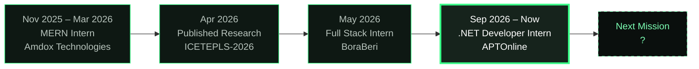

<div align="center">



<a href="https://git.io/typing-svg">

</a>

<p>


</p>

<a href="https://rohithsurapaneni9866.github.io/domain/">

</a>

</div>

---

## ▌BOOT SEQUENCE

```text
> initializing sovereign.sys ................ [ OK ]
> loading identity .......................... S ROHITH KUMAR
> role ...................................... FULL STACK DEVELOPER
> current post .............................. .NET DEVELOPER INTERN @ APTONLINE (TCS RTI)
> stack ..................................... ASP.NET CORE / REACT / NODE / PYTHON
> published ................................. ICETEPLS-2026
> concurrency record ........................ 80+ USERS, <100ms LATENCY
> mode ...................................... BUILDING. ALWAYS.
> awaiting next mission ..................... _
```

---

## ▌CLASSIFIED DOSSIER

| Field | Entry |
|---|---|
| **Designation** | S Rohith Kumar |
| **Domain** | Enterprise backends, REST APIs, real-time distributed systems |
| **Specialty** | Turning slow queries and shaky architecture into fast, secure systems |
| **Obsession** | Secure application development and scalable design |
| **Current research** | AI engineering and modern software architecture |
| **Open to** | Full-stack, backend and Python collaborations |
| **Location** | Vijayawada, India (working in Hyderabad) |

---

## ▌ROYAL DECREE · LIVE INTELLIGENCE

<div align="center">

<br/>
<sub>Auto-updated by GitHub Actions · last decree: <!--UPDATED_START-->pending first run<!--UPDATED_END--></sub>
</div>

---

## ▌ARSENAL

<div align="center">


</div>

| Rank | Weapons |
|---|---|
| 🟢 **Primary** | C#, ASP.NET Core, SQL Server, Entity Framework Core, React.js, Node.js, Express.js, MongoDB, JWT |
| 🟡 **Secondary** | TypeScript, Python, Django, MySQL, Socket.io, Jest, REST API design |
| 🔵 **Exploring** | AI engineering, microservices, system design, CI/CD |
| 🔴 **Security toolkit** | OWASP ZAP, Burp Suite, authentication and authorization patterns |

**Also in the vault:** Google Maps API · React Hook Form · Zod · Git · Linux

---

## ▌CAMPAIGN MAP



### 📂 Open the case files

<details open>
<summary><b>FILE 003 · .NET Developer Intern · APTOnline</b> &nbsp;(Sep 2026 – Present · Hyderabad)</summary>
<br/>

`C#` `ASP.NET Core` `SQL Server` `Entity Framework Core`

- Developed enterprise backend microservices
- Built **8+ RESTful APIs**
- Implemented dependency injection, middleware and async/await
- Improved SQL Server performance by **20%+** through query optimization
- Implemented JWT authentication and role-based access control
- Managed database migrations with Entity Framework Core

</details>

<details>
<summary><b>FILE 002 · Full Stack Developer Intern · BoraBeri</b> &nbsp;(May 2026 · Remote)</summary>
<br/>

`React.js` `TypeScript` `Node.js` `Express.js` `MongoDB` `Socket.io`

- Built a talent management platform supporting **80+ concurrent users**
- Real-time messaging with typing indicators, read receipts, threads and file sharing
- Achieved **<100ms** messaging latency
- Secure onboarding, authentication and portfolio management
- Developed booking, billing and invoice modules
- Maintained **95%+** code quality standards through Jest testing

</details>

<details>
<summary><b>FILE 001 · MERN Stack Developer Intern · Amdox Technologies</b> &nbsp;(Nov 2025 – Mar 2026 · Remote)</summary>
<br/>

`React.js` `Node.js` `Express.js` `MongoDB` `MySQL`

- Built and deployed **3 full-stack applications**
- Developed a Certificate Verification System
- Created Job Portal APIs with **15+ endpoints**
- Implemented JWT authentication and RBAC
- Built Excel bulk-ingestion and validation pipelines
- Optimized database queries and application performance

</details>

---

## ▌FORTRESSES

| Fortress | Purpose | Weapons |
|---|---|---|
| **BoraBeri** | Real-time talent management and booking platform: messaging, onboarding, pricing, billing, notifications | React, TypeScript, Node, Express, MongoDB, Socket.io |
| [**Certificate Verification System**](https://github.com/Rohithsurapaneni9866/amdox-3.2-certificate-verifiation-system.git) | Excel bulk upload, certificate search, verification, document retrieval, authentication | MongoDB, Express, React, Node, JWT |
| [**EV Charging Station Locator**](https://github.com/Rohithsurapaneni9866/EV-charging-locator-.git) | Geospatial app for charging stations and optimized routes with Google Maps | JavaScript, APIs, Google Maps |
| **AgriMarket** | Digital ecosystem connecting agricultural buyers and sellers | MERN Stack |

### ⚡ Recent conquests (auto-generated)

<!--RECENT_START-->
*The first scheduled run will fill this table.*
<!--RECENT_END-->

---

## ▌SCHOLARLY WORKS

> **EV Charging Station Locator with Google Maps Integration**
> *ICETEPLS-2026 Conference · April 2026*
>
> - Designed a distributed real-time data pipeline using Google Maps API and PlugShare REST APIs
> - Built a geospatial aggregation system covering **40+ charging stations**
> - Improved database query performance by **30%**
> - Presented research on distributed systems, API integration and performance optimization

---

## ▌BATTLE RECORDS

<div align="center">


<br/>


</div>

---

## ▌ACADEMY RECORDS

| Degree | Institution | Years |
|---|---|---|
| **Master of Computer Applications (MCA)** | SAHE University, Vijayawada | 2024 – 2026 |
| **B.Sc. Computer Science** | Nalanda Degree College, Vijayawada | 2020 – 2023 |

---

## ▌SEEK AN AUDIENCE

<div align="center">

<a href="https://linkedin.com/in/rohith-kumar-b363ba381/"></a>
<a href="https://github.com/rohithsurapaneni9866"></a>
<a href="https://rohithportfolio03-2026.netlify.app/"></a>
<a href="mailto:rohithsurapaneni9866@gmail.com"></a>

<br/><br/>

### *"Building today. Innovating tomorrow."*


</div>
